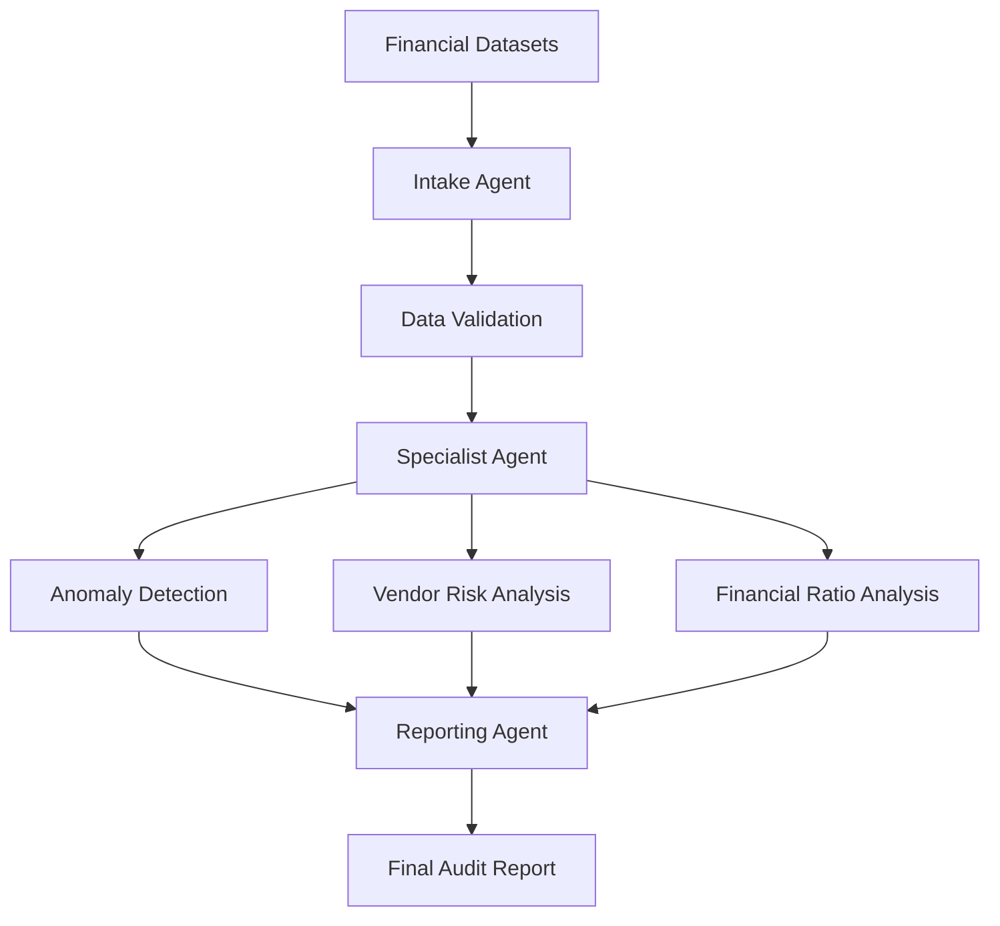

# AuditPilot 🔍

### AI-Powered Multi-Agent Financial Audit System

AuditPilot is a Python-based financial audit automation project that combines deterministic audit checks with a multi-agent AI workflow to analyze synthetic financial transaction data and generate structured audit reports.

## 🚀 Project Overview

Traditional financial audits involve checking large volumes of transactions to identify unusual patterns, data quality issues, and potential financial risks.

AuditPilot automates several of these checks using Python-based audit tools and Google Agent Development Kit (ADK).

The system processes financial datasets through three specialized AI agents and generates a consolidated audit report.

## 🏗️ System Architecture



## 🤖 Multi-Agent Workflow

### 1. Intake Agent
- Validates financial ledger data.
- Checks missing values and duplicate records.
- Verifies trial balance debit and credit totals.
- Reports data readiness.

### 2. Specialist Agent
Runs deterministic audit tools to identify:

- Benford's Law anomalies.
- Duplicate payments.
- Split payments.
- Weekend and round-number payments.
- Approval-limit violations.
- Ghost vendors.
- Prompt injection attempts in transaction descriptions.
- Shared bank accounts.
- Financial ratio indicators.

### 3. Reporting Agent
Generates a consolidated report containing:

1. Executive Summary
2. Data Validation Results
3. Anomaly Detection Findings
4. Vendor Risk Analysis
5. Financial Ratio Analysis
6. Risk Assessment
7. Audit Recommendations
8. Final Conclusion

## 🛠️ Technologies Used

- Python
- Google ADK
- Gemini 3.8 Flash
- Pandas
- NumPy
- Pytest
- Git and GitHub

## 📂 Project Structure

```text
auditpilot/
│
├── auditpilot/
│   ├── agents/
│   │   ├── intake.py
│   │   ├── anomaly.py
│   │   ├── vendor.py
│   │   ├── ratio.py
│   │   ├── specialists.py
│   │   └── reporting.py
│   │
│   ├── tools/
│   │   ├── data_tools.py
│   │   └── audit_tools.py
│   │
│   └── agent.py
│
├── data/
│   ├── ledger.csv
│   ├── vendors.csv
│   ├── employees.csv
│   ├── financials.csv
│   ├── trial_balance.csv
│   ├── ground_truth.csv
│   └── policy.md
│
├── scripts/
│   └── make_data.py
│
├── tests/
├── docs/
├── evals/
├── requirements.txt
└── README.md
```

## 📊 Dataset

AuditPilot uses a synthetic financial dataset generated using Python.

| Dataset | Records |
|---|---:|
| Ledger transactions | 6,000 |
| Vendors | 120 |
| Employees | 40 |
| Ground-truth anomaly records | 70 |

The synthetic dataset includes planted examples of suspicious transaction patterns for testing and evaluation.

## ⚙️ Installation and Setup

### 1. Clone the repository

```bash
git clone https://github.com/satavyash59-lgtm/auditpilot.git
cd auditpilot
```

### 2. Create a virtual environment

```bash
python -m venv .venv
```

### 3. Activate the environment

Linux:

```bash
source .venv/bin/activate
```

### 4. Install dependencies

```bash
pip install -r requirements.txt
```

### 5. Configure environment variables

Create a `.env` file and configure the required Gemini API credentials according
